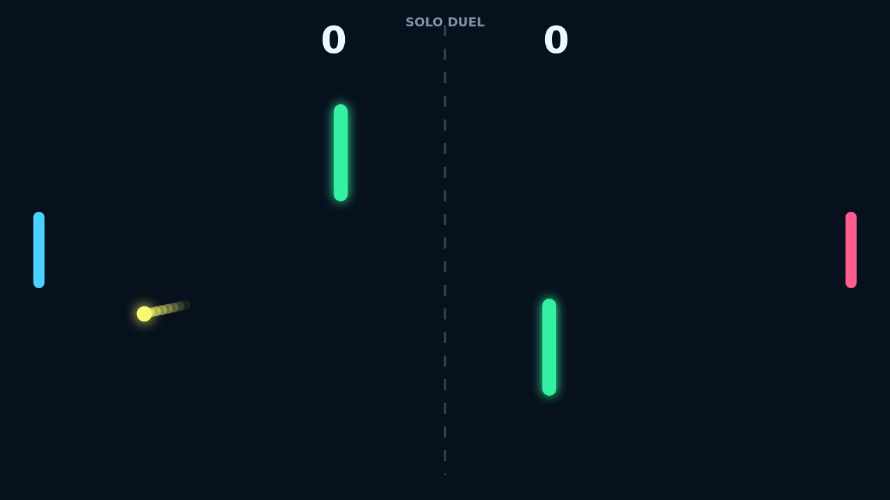

# Carom

Carom turns the familiar paddle duel into a sharp little bank-shot contest. The
ball does not just rebound; it bends from the motion of the paddle that struck
it, so a late upward swipe can send the next return curling into open space.

The two center posts make every rally feel tactical. A straight shot is rarely
the only answer, and the best points come from threading the ball past a paddle,
off a post, and back across the field before the defender can reset.

Solo play puts the right side under a quick AI defender, while Versus lets two
players share the keyboard for local matches. First to 11 wins, but only with a
two-point lead, so close games become tense spin-heavy exchanges around match
point.
